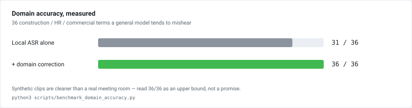
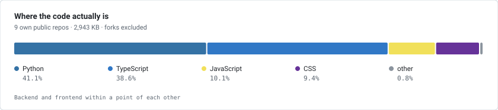
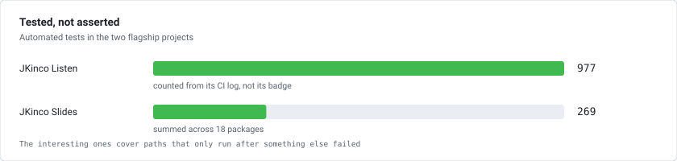

  

<h1 align="center">Wenxuan Zhang · 张文瑄</h1>

  <b>LLM Product Lead · AI Application Engineer · Forward Deployed Engineer</b> 
  Shanghai Jianke · Imperial College London (MEng)

  <b>From frontier AI to products people love.</b> 
  I turn operationally hard workflows into AI products that ship — from field problem to production.

  
  
  
  

  <b>English</b> · <a href="README.zh-CN.md">简体中文</a>

---

## Builder · Product Thinker · Global AI Builder

The most valuable AI products are rarely chatbots. They replace a real workflow with many
owners, messy inputs, domain language, privacy boundaries, and a document or decision that
must survive scrutiny.

<table>
<tr>
<td width="33%" valign="top">
<b>01 · Builder</b>  
Turn the idea into a working product, not a technology keyword. I build across application,
agent, infrastructure, and deployment layers, then prove the result with shipped software,
source code, live demos, and measurable failure-path coverage.
</td>
<td width="33%" valign="top">
<b>02 · Product Thinker</b>  
Start with the user's pain, the decision path, the accountable owner, and the cost of being
wrong. Then choose the model boundary, UX, evaluation loop, positioning, and commercial
trade-offs around that reality.
</td>
<td width="33%" valign="top">
<b>03 · Global AI Builder</b>  
Build for an international audience: English-first documentation with a complete Chinese
version, transparent demos, reproducible benchmarks, open issues, and a product direction that
can be understood and extended by developers worldwide.
</td>
</tr>
</table>

---

## Flagship: JKinco Listen · 筑听

**A live meeting product for any high-context conversation — hardened in construction
supervision, not limited to it.**

The production product records with a phone or **筑听 Z1**, streams a live transcript,
generates structured minutes, exports Word/PDF, and answers questions grounded in the meeting.
The open edition turns the same product direction into a self-hosted stack with LiveKit, local
ASR/LLM, source access, and a verifiable privacy boundary.

  
  
  
  
  

  

  <a href="https://jkincolisten.cloud"><b>Product website</b></a> ·
  <a href="https://jkincolisten.cloud/download/ios"><b>iOS</b></a> ·
  <a href="https://jkincolisten.cloud/download/android"><b>Android</b></a> ·
  <a href="https://jkincolisten.cloud/download/harmony/app.hap"><b>HarmonyOS</b></a> ·
  <a href="https://github.com/wenxuanzhang1209-cyber/jkinco-listen-open"><b>Open source</b></a>

### One product system, three surfaces

<table>
<tr>
<td width="46%" valign="top">

</td>
<td width="54%" valign="top">
<b>筑听 Z1 · capture hardware</b>  
A roughly 44 g magnetic recorder card with dual omnidirectional microphones and a
bone-conduction microphone. The published product card lists 8 / 16 / 32 / 64 GB storage,
iOS / Android support, and recognition across 120+ languages and dialects.
  
In the production app, Z1 sits beside phone recording as a first-class capture source for
meetings where pulling out a phone changes the room.
</td>
</tr>
</table>

### Why it is more than an AI wrapper

- **Useful while the meeting is still happening.** Live captions and structured minutes are
  part of the same flow, not a post-processing add-on.
- **General product, demanding proof.** Management reviews, customer calls, interviews,
  training, and research are first-class uses. Engineering supervision is the stress test
  because an incorrect owner or responsibility changes the meaning of the document.
- **A defensible trust boundary.** The open edition can run without cloud model calls; CI
  scans the working tree and Git history for API keys, cloud-model traces, and production
  infrastructure details.
- **Measured domain quality.** On ten noisy Chinese meeting clips and 36 high-risk terms,
  local ASR alone recognized 31 / 36; domain correction reached 36 / 36. The synthetic clips
  are cleaner than a real room, so that result is an upper bound, not a promise.
- **977 tests** in the open repository, covering API, security, concurrency,
  templates, export, real-time meetings, and failure paths.

  <picture>
    <source media="(prefers-color-scheme: dark)" srcset="assets/chart-benchmark-dark.svg" />
    
  </picture>

### Product case study: from idea to impact

| Stage | Product decision | Public evidence |
|---|---|---|
| **User insight** | Meetings need value during the conversation, not only a summary after it | Live transcript, automatic minutes, and grounded Q&A in one flow |
| **Product design** | Separate the ready-to-use app from the auditable self-hosted edition | iOS / Android / HarmonyOS product and MIT Open Edition |
| **AI engineering** | Keep model quality observable and the data boundary explicit | Evidence-gated classification, measured domain correction, local ASR / LLM, DOCX/PDF |
| **Deployment** | Make the first useful path short for both users and developers | Three-platform download page, Docker Compose, one-command launch |
| **Adoption evidence** | Publish only what can be verified publicly | Live app, Z1 capture surface, v0.2.0 release, 977 tests, reproducible benchmark |

Commercial adoption and revenue figures are not claimed here. The public proof is the shipped
product, open source, tests, benchmark, documentation, and release history.

### Engineering excellence

| Area | What is implemented |
|---|---|
| **Real-time systems** | Self-hosted LiveKit media, streaming captions, reconnects, meeting controls, and browser UX |
| **Applied models** | Local ASR, domain correction, evidence-gated classification, local LLM generation, and grounded Q&A |
| **Evaluation & reliability** | A reproducible domain benchmark, 977 tests, CI checks, failure-path coverage, and release contracts |
| **Security boundaries** | Redacted secret scanning, production/cloud boundary checks, explicit local credentials, and security documentation |
| **AI-native delivery** | Codex, Claude, and modern coding workflows used to move from prototype to tested implementation |

### A focused layer in the enterprise AI stack

DingTalk, Tencent Meeting, and Feishu already own broad collaboration, identity, messaging,
and distribution. The opportunity for JKinco is not to rebuild that suite.

It is to become the trusted capture-and-document layer that can operate inside strict data
boundaries, preserve evidence and accountability, and adapt deeply to a workflow — then
integrate with the platforms already used by the enterprise. Broad suites win reach; focused
products win the hardest last mile.

---

## Featured products & projects

<table>
<tr>
<td width="50%" valign="top">

 <b><a href="https://github.com/wenxuanzhang1209-cyber/jkinco-slides">JKinco Slides</a></b>
 AI-native presentation studio where every object stays editable and PPTX survives the round trip.
 <code>18 packages · 269 tests</code>
</td>
<td width="50%" valign="top">

 <b><a href="https://github.com/wenxuanzhang1209-cyber/JKinco-Skills-Lab">JKinco Skills Lab</a></b>
 Brand and design knowledge frozen into reusable agent skills, with reference art as the contract.
 <code>2 skills + reference system</code>
</td>
</tr>
<tr>
<td width="50%" valign="top">

 <b><a href="https://github.com/wenxuanzhang1209-cyber/personal-life-hub">NORTH · Life Hub</a></b>
 One timeline for work and life with explicit boundaries and local-only data.
 <code>localStorage only · zero network calls</code>
</td>
<td width="50%" valign="top">

 <b><a href="https://github.com/wenxuanzhang1209-cyber/recipe-miniprogram">Recipe Mini Program</a></b>
 A WeChat mini-program with production-scale data and an included quality audit that names its own defects.
 <code>10,000 recipes · 96,908 ingredient links</code>
</td>
</tr>
<tr>
<td colspan="2" valign="top">
<b><a href="https://github.com/wenxuanzhang1209-cyber/jkinco-tools">JKinco Tools</a></b> ·
small automation utilities that verify their own output. The mirror tool re-hashes every copied
file and compares it with the Git object hash: <code>6,407 files, 0 failures</code>, standard
library only.
</td>
</tr>
</table>

### Xiaozhi Coding · pre-release, not yet public source

An exploration of an AI-native coding harness: natural-language intent → agent planning → file
and Git changes → verification → reviewable delivery. A public release will only be considered
after explicit IP, licence, security, and company-publication review. This page does not claim
an available repository or open-source licence before that review is complete.

---

## Open-source ecosystem

The public entry points are deliberately practical:

- **Try it:** [production app and three-platform downloads](https://jkincolisten.cloud/download/ios)
- **Run it:** [Open Edition quick start](https://github.com/wenxuanzhang1209-cyber/jkinco-listen-open#quick-start-docker)
- **Understand it:** [architecture](https://github.com/wenxuanzhang1209-cyber/jkinco-listen-open/blob/main/docs/ARCHITECTURE.en.md) and [benchmark](https://github.com/wenxuanzhang1209-cyber/jkinco-listen-open/blob/main/docs/BENCHMARK.md)
- **Evaluate it:** [v0.2.0 release](https://github.com/wenxuanzhang1209-cyber/jkinco-listen-open/releases/tag/v0.2.0), CI, and security policy
- **Contribute:** [contributing guide](https://github.com/wenxuanzhang1209-cyber/jkinco-listen-open/blob/main/CONTRIBUTING.md), [roadmap](https://github.com/wenxuanzhang1209-cyber/jkinco-listen-open/blob/main/docs/ROADMAP.en.md), and [Discussions](https://github.com/wenxuanzhang1209-cyber/jkinco-listen-open/discussions)

Integration recipes for collaboration platforms are a roadmap direction, not an existing
vendor certification or claimed partnership.

---

## Experience & education

| | |
|---|---|
| **Current role** | AI Application Engineer / large-model product lead at Shanghai Jianke Engineering Consulting Co., Ltd. |
| **Education** | Imperial College London — MEng |
| **Experience across** | Vertical AI products · agents and personal agents · AI infrastructure · model training and fine-tuning · operations · UX · product strategy · international collaboration |
| **Working style** | Start with the workflow and its failure cost. Build the measurable slice. Ship it. Keep the evidence inspectable. |

## Tools I reach for

  
  
  
  
  
  
  
  
  
  

## Evidence is part of the product

The numbers on this page are re-measured by a
[weekly workflow](.github/workflows/verify-numbers.yml). The charts are generated from the
GitHub API rather than borrowed from a stats card, and they exclude repositories I merely
forked.

  <picture>
    <source media="(prefers-color-scheme: dark)" srcset="assets/chart-languages-dark.svg" />
    
  </picture>
  <picture>
    <source media="(prefers-color-scheme: dark)" srcset="assets/chart-tests-dark.svg" />
    
  </picture>

---

## Let's build the missing layer

I am open to conversations about:

- forward-deployed and AI product roles, especially where product judgment and hands-on
  engineering are expected in the same person;
- enterprise pilots where privacy, accountability, or domain language makes generic tools
  insufficient;
- open-source collaboration around local-first AI, meeting intelligence, and agent harnesses;
- investment conversations around vertical AI products and local-first infrastructure.

  

  
  <b>JKinco</b> · production AI, local-first systems, and open evidence ·
  <a href="https://github.com/wenxuanzhang1209-cyber/jkinco-listen-open">Listen</a> ·
  <a href="https://github.com/wenxuanzhang1209-cyber/jkinco-slides">Slides</a> ·
  <a href="https://github.com/wenxuanzhang1209-cyber/JKinco-Skills-Lab">Skills Lab</a> ·
  <a href="https://github.com/wenxuanzhang1209-cyber/jkinco-tools">Tools</a>
  

