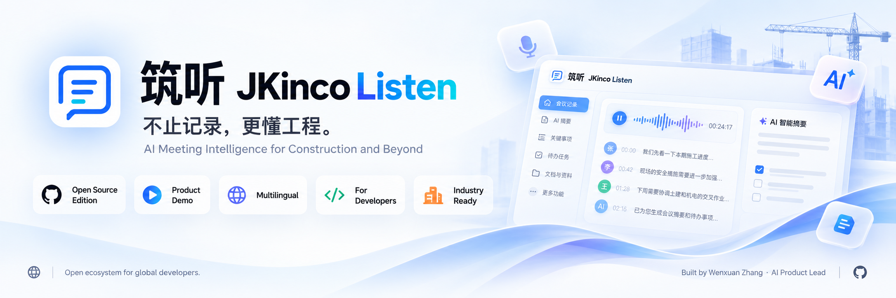

  

<h1 align="center">张文瑄 · Wenxuan Zhang</h1>

  <b>大模型产品负责人 · AI 应用工程师 · FDE 前线部署工程师</b> 
  AI 产品构建者 · 帝国理工学院 MEng · 上海建科工程咨询

  <b>做真正有价值的 AI 产品。</b> 
  <b>从前沿 AI 技术，到真实世界的产品影响。</b>

  把复杂工作流与前沿 AI 能力，转化为直观、可靠、可规模化的产品。能力覆盖 AI Agent、
  AI 工程、产品与 UX、开源协作及商业化交付。

  <b>产品主导与实现：</b>筑听 JKinco Listen 端到端软件产品——战略、UX、架构、AI 工程、
  代码实现、测试、上线与开源——均由我独立设计并开发。

  
  
  
  

  <a href="README.md">English</a> · <b>简体中文</b>

---

## AI Builder：产品 · 工程 · 交付 · 全球视野

我不把自己限定在某一个模型、某一个行业或某一种产品形态。我结合产品判断、亲手工程、
可验证的交付证据与国际化产品视角，把困难工作流转化为真正有用的 AI 系统。

<table>
<tr>
<td width="50%" valign="top">
<b>01 · AI 产品构建者</b>  
发现用户问题、定义产品、设计体验、完成商业取舍，并对上线与迭代结果负责。
</td>
<td width="50%" valign="top">
<b>02 · 亲手 AI 工程</b>  
构建 AI Agent、LLM 应用、多模态系统、实时基础设施、模型评测、微调工作流与生产界面。
</td>
</tr>
<tr>
<td width="50%" valign="top">
<b>03 · 已交付产品</b>  
用上线产品、可运行演示、源码、版本记录、测试与清晰的证据边界证明能力，而不是只列技术名词。
</td>
<td width="50%" valign="top">
<b>04 · 全球视野与商业判断</b>  
面向国际采用与开放协作设计产品，同时理解从用户价值走向商业价值的可重复路径。
</td>
</tr>
</table>

---

## 旗舰产品：筑听 JKinco Listen

**会议驱动的 AI 工作执行平台 · Meeting-to-Action AI Platform**

**会议结束，AI 继续把事办完。**

目前，筑听支持手机或 **筑听 Z1** 采集，实时转写，生成包含决策与责任主体的结构化纪要，
导出 Word/PDF，并可基于会议原文与纪要继续追问。开源版把同一方向变成 LiveKit + 本地
ASR/LLM 的自托管方案，开放源码，并用可执行检查守住隐私边界。

下一阶段是让 Personal Agent 在获得授权后，携带会议上下文推进文档、任务与后续执行，并连接
办公系统。**WorkBuddy 连接已经完成并上线**；MCP/API 扩展是下一层互操作能力。

  
  
  
  

  <a href="https://jkincolisten.cloud"><b>产品官网</b></a> ·
  <a href="https://jkincolisten.cloud/download/ios"><b>iOS 可用性</b></a> ·
  <a href="https://jkincolisten.cloud/download/android"><b>安卓</b></a> ·
  <a href="https://jkincolisten.cloud/download/harmony/app.hap"><b>鸿蒙</b></a> ·
  <a href="https://github.com/wenxuanzhang1209-cyber/meetdo"><b>Open Edition</b></a>

> **分发说明：** 截至 2026-10-29，正式版 iOS 页面使用运营方管理的安装流程。本页不宣称已经
> 上架 App Store 或通过 TestFlight 分发。国际评估建议使用 Open Edition，或申请有支持的试用。

  

### 不只是结果，而是完整的工作流

<table>
<tr>
<td width="33%" valign="top" align="center">

 <b>01 · 现场采集</b> 
手机或筑听 Z1 的音频，在会议进行中实时变成带说话人的转写。
</td>
<td width="33%" valign="top" align="center">

 <b>02 · 自动成稿</b> 
决策、责任主体、风险和待办沉淀为可编辑文档，并支持 Word/PDF 导出。
</td>
<td width="33%" valign="top" align="center">

 <b>03 · 妙思追问</b> 
基于会议原文和纪要持续追问，获得有出处的答案与补充上下文。
</td>
</tr>
</table>

### 硬件、实时 App 与 Open Edition

<table>
<tr>
<td width="38%" valign="top">

</td>
<td width="62%" valign="top">
<b>筑听 Z1 · 采集硬件</b>  
约 44 g 的磁吸录音卡，双全向麦克风加 1 个骨传导麦克风。公开产品卡列出的配置包括
8 / 16 / 32 / 64 GB 存储、Android / iOS 支持，以及 120+ 种语言和方言识别。
  
我把 Z1 与手机录音整合为产品中的一等采集入口。Z1 的硬件选型与制造不属于下文所述的
端到端软件研发，但 App 接入、采集流程与整体体验由我完成。
</td>
</tr>
</table>

### 我的职责：独立完成端到端产品研发

**筑听 JKinco Listen 软件产品从最初的工作流问题，到正式 App 与 Open Edition，均由我独立设计、
开发并推进上线。**

| 产品阶段 | 我具体设计、开发并交付了什么 |
|---|---|
| **用户与市场研究** | 研究高信息密度会议、责任链、文档出错代价，以及通用云端记录工具与受监管专业工作流之间的差距 |
| **产品战略** | 定义产品命题、通用市场定位、建筑领域压力测试、正式版/开源版边界、功能范围、路线图与关键取舍 |
| **UX 与界面** | 设计信息架构、录音流程、实时转写、会议历史、纪要编辑、模板选择、Sona 问答与导出体验 |
| **实时音频** | 构建 LiveKit 自托管会议链路，包括麦克风/屏幕共享、流式字幕、断线重连、会议控制与本地 ASR 传输 |
| **语音与领域层** | 实现 FunASR 本地识别、VAD、标点、领域词库、实测纠错规则，以及支撑 31/36 → 36/36 的评测闭环 |
| **纪要智能** | 实现证据门控会议分类、结构化抽取、分块生成、合并复核、五类场景模板、自定义 DOCX 模板与 DOCX/PDF 导出 |
| **Sona 与模型接入** | 实现基于会议原文与纪要的问答，以及 Ollama 本地模型和 OpenAI-compatible 模型适配层 |
| **后端与数据** | 构建 FastAPI 服务、登录认证、用户历史、模板存储与配额、任务队列、限流、安全 Header 与审计式错误处理 |
| **跨端交付** | 完成浏览器工作台，并打通手机、Z1、iOS、Android、HarmonyOS 与产品下载站的正式产品链路 |
| **可靠性与安全** | 建立 Open Edition 打包、Docker 部署、CI、密钥与云端边界扫描、异常路径测试和可复现领域基准 |
| **发布与开源** | 设计产品与下载体验、演示、Release Notes、架构/安全文档、贡献路径、路线图与公开开源版 |

### 产品原则

- **会议结束前，价值就开始产生。** 实时字幕、会议上下文与结构化记录属于同一条工作流，
  而不是三个割裂的工具。
- **文档必须保留责任关系。** 决策、责任主体、风险与待办，比一份丢失责任归属的漂亮摘要更重要。
- **通用产品，极端场景压测。** 管理层会议、客户沟通、面试、培训与研究访谈都是核心场景；
  建筑领域是压力测试，因为复杂责任链会让错误的责任主体直接改变文件含义。
- **两种部署，一个产品方向。** 正式 App 优化首次使用价值；Open Edition 开放源码、本地
  ASR/LLM 能力与自托管信任边界。

### 不止会议纪要：从对话走向执行

长期品类不只是转写，而是把真实会议变成经过授权、结构化的上下文，让 Personal Agent 能够据此
准备工作并持续跟进。

| 层级 | 状态 | 已实现或拟建设能力 |
|---|---|---|
| **会议智能** | **已上线** | 手机/Z1 采集、实时转写、结构化纪要、决策与责任人、DOCX/PDF 导出 |
| **基于会议上下文的个人智能体** | **已以 Sona 问答形态上线** | 围绕会议与纪要继续追问，补齐上下文、后续事项和缺失信息 |
| **会后任务编排** | **产品方向** | 在用户明确授权下拆解任务、起草文档、提醒跟进与更新状态 |
| **办公生态连接** | **WorkBuddy 已上线** | 已完成 WorkBuddy 连接，可把授权会议上下文带入其工作流；

<b>连接器接口契约</b>——逐项公开可用性随 Release 文档发布

| 拟定能力 | 用途 |
|---|---|
| `list_meetings` | 获取用户授权范围内的会议列表 |
| `get_meeting_summary` | 返回已确认的摘要、决策与纪要 |
| `get_action_items` | 返回责任人、截止时间与待办状态 |
| `get_meeting_context` | 返回经授权的转写片段与来源时间戳 |
| `update_action_status` | 将执行结果回写到原会议 |
| `create_followup` | 创建关联原会议的后续任务或文档请求 |

涉及对外发送、责任分配和业务系统变更的写操作，必须包含明确授权、幂等处理与审计记录。

### Benchmark：能证明什么，不能证明什么

| 范围 | 事实 |
|---|---|
| **测了什么** | 10 段合成并加噪的中文会议音频，36 个领域目标词 |
| **观察结果** | 纯本地 ASR **31/36**；加入领域纠错后 **36/36**，修复 5 个未命中项 |
| **基线** | 同一条本地流水线加入纠错前的结果；不包含云端 ASR 横向对比 |
| **没有测什么** | CER/WER、置信区间、真实会议室准确率、广泛多语种 ASR 准确率，或相对其他产品的优越性 |
| **适用方式** | 领域纠错层的可复现回归与冒烟测试 |

Open Edition 的 977 个自动化检查代表发布工程与异常路径工作量，不单独作为产品质量结论。

### 我做的三个关键产品决策

| 决策 | 为什么这样选 | 结果 |
|---|---|---|
| **优先服务“会议进行中”** | 会后总结会丢掉上下文、追问和责任形成的最有价值时刻 | 实时转写、持续生成的纪要与 Sona 问答共享同一条有状态链路 |
| **场景判断先规则、后模型** | 模型可能给出有说服力却错误的模板，进而写错责任关系，因此必须有可阻断的证据门 | 证据门控分类；模型可以降级结果，但不能提升弱证据结论 |
| **正式 App 与 Open Edition 分开** | 普通用户需要最短路径；开发者和受监管团队需要源码与可验证边界 | 正式产品与 MIT Open Edition 共享方向，但不假装是同一构建 |

### 与现有企业平台互补

钉钉、腾讯会议、飞书及更广泛的协作套件，在身份、消息、会议与分发上具备优势。筑听聚焦相邻的
「采集—证据—责任—文档」层：保留可追溯依据，维护责任归属，适配具体工作流，并让会议结果
离开会议后仍可继续使用。

这是互操作方向，不代表已经获得厂商认证或形成官方合作。

---

## 代表项目

<table>
<tr>
<td width="50%" valign="top">

 <b><a href="https://github.com/wenxuanzhang1209-cyber/jkinco-slides">JKinco Slides</a></b>
 AI 原生演示文稿工作台，聚焦对象可编辑、可验证的 PPTX 往返与清晰的包边界。
 <code>18 packages · 269 tests</code>
</td>
<td width="50%" valign="top">

 <b><a href="https://github.com/wenxuanzhang1209-cyber/JKinco-Skills-Lab">JKinco Skills Lab</a></b>
 把设计知识固化为可复用 Agent Skills，并让参考图成为输出契约的一部分。
 <code>2 个 skill + 一套参考体系</code>
</td>
</tr>
<tr>
<td colspan="2" valign="top">
<b>XiaoZhi Harness · 预研阶段，尚未公开发布源码</b>  
面向「意图 → 规划 → 文件与 Git 修改 → 验证 → 可审查交付」的 Agent Harness。我正在准备
清洁候选版：安全命令默认值、移除完全访问模式、凭据加密、仅监听本机、来源审查、密钥扫描与
合成演示数据。知识产权与公司发布权限审核完成前，不宣称已有公开仓库或开源许可证。
</td>
</tr>
</table>

其他公开实验：[NORTH](https://github.com/wenxuanzhang1209-cyber/personal-life-hub)、
[家常菜小程序](https://github.com/wenxuanzhang1209-cyber/recipe-miniprogram) 与
[JKinco Tools](https://github.com/wenxuanzhang1209-cyber/jkinco-tools)。

---

## 开源生态

公开入口以可执行为先：

- **查看正式产品：** [筑听 JKinco Listen](https://jkincolisten.cloud)，平台可用性因分发渠道而异
- **申请国际试用：** [发送邮件](mailto:wenxuanzhang1209@gmail.com?subject=JKinco%20Listen%20pilot)
- **本地运行：** [Open Edition Docker 快速开始](https://github.com/wenxuanzhang1209-cyber/meetdo#quick-start-docker)
- **理解架构：** [技术架构](https://github.com/wenxuanzhang1209-cyber/meetdo/blob/main/docs/ARCHITECTURE.md) 与 [领域基准](https://github.com/wenxuanzhang1209-cyber/meetdo/blob/main/docs/BENCHMARK.md)
- **评估质量：** [v0.2.0 Release](https://github.com/wenxuanzhang1209-cyber/meetdo/releases/tag/v0.2.0)、CI 与安全策略
- **参与共建：** [贡献指南](https://github.com/wenxuanzhang1209-cyber/meetdo/blob/main/CONTRIBUTING.md)、[路线图](https://github.com/wenxuanzhang1209-cyber/meetdo/blob/main/docs/ROADMAP.md) 与 [Discussions](https://github.com/wenxuanzhang1209-cyber/meetdo/discussions)

与协作平台的集成 Recipe 属于路线图方向，不代表已经实现、获得认证或形成官方合作。

## 负责任部署

会议记录可能包含个人信息、商业信息或受监管数据。正式部署与运营流程应明确：

- 符合所在司法辖区要求的参与者告知与录音同意；
- 音频、转写和纪要究竟留在设备、私有部署，还是跨越模型供应商边界；
- 留存、删除、权限控制与数据主体请求处理；
- 对责任主体、决策、风险等高影响字段进行人工复核；
- 转写或模型输出不完整、错误时的升级与纠错路径。

Open Edition 提供本地/自托管路径，但不能替代组织自己的法律、隐私、安全与档案合规审查。

## 经历与教育

| | |
|---|---|
| **当前工作** | 上海建科工程咨询有限公司，FDE 前线部署工程师 / AI 应用工程师 / 大模型产品负责人 |
| **教育** | 帝国理工学院（Imperial College London）MEng |
| **能力跨度** | 垂直行业 AI · AI Agent 与个人助手 · AI 基础设施 · 模型训练与微调 · 产品运营 · UX · 市场洞悉 · 产品策略 · 国际合作 |
| **核心技术栈** | Python · TypeScript · React · FastAPI · LiveKit · FunASR · Ollama · OpenAI-compatible models · Docker · Codex · Claude · AI-native development |
| **工作方式** | 从工作流和错误代价出发，先做可测量的最小闭环，尽快上线，并让证据与边界保持可复核。 |

---

## 共建开源生态

欢迎交流这些方向：

- FDE、AI 产品负责人等既要求产品判断、也要求亲手工程落地的岗位；
- 对隐私、责任追溯和行业语言有真实要求的企业试点；
- 本地优先 AI、会议智能和 Agent Harness 方向的开源协作；
- 垂直 AI 产品与本地优先基础设施方向的投资交流。

  

  
  <b>JKinco</b> · 正式产品、本地优先系统与可验证证据 ·
  <a href="https://github.com/wenxuanzhang1209-cyber/meetdo">筑听</a> ·
  <a href="https://github.com/wenxuanzhang1209-cyber/jkinco-slides">Slides</a> ·
  <a href="https://github.com/wenxuanzhang1209-cyber/JKinco-Skills-Lab">Skills Lab</a> ·
  <a href="https://github.com/wenxuanzhang1209-cyber/jkinco-tools">Tools</a>
  

